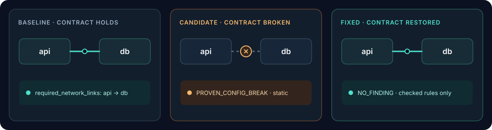
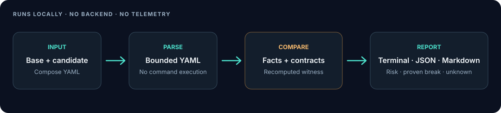

<p align="center">
  <picture>
    <source media="(prefers-color-scheme: dark)" srcset="assets/brand/wordmark-dark.svg">
    
  </picture>
</p>

<p align="center"><a href="README.md">English</a> | <a href="README.ru.md">Русский</a></p>

<p align="center"><strong>Know what breaks before you deploy.</strong><br>
Compare Docker Compose changes, check declared contracts, and get a deterministic explanation when one is broken.</p>

<p align="center">
  <a href="docs/ARCHITECTURE.md">How it works</a> ·
  <a href="docs/SECURITY_ARCHITECTURE.md">Security</a> ·
  <a href="ROADMAP.md">Roadmap</a> ·
  <a href="CONTRIBUTING.md">Contributing</a>
</p>

---

## The problem

A Compose change can remove a service, detach two services from a shared network, or change a persistent mount. A linter can flag suspicious syntax; it usually does not compare the old and new service relationships or say which declared invariant changed.

DeployWitness compares two configurations. It reports a **proven configuration break** only when a checkable invariant was true in the baseline and is false in the candidate. A change without that contract is a **risk**, not a proven outage.

## See it in action

The example baseline declares that `api` and `db` must share a network. The candidate moves `api` to another network. The repaired example restores the declared relationship.



Run the comparison from the repository root:

```console
$ deploywitness check --base examples/before/compose.yaml --head examples/after/compose.yaml
PROVEN_CONFIG_BREAK COMPOSE_NETWORK_LINK api->db: Required or previously shared service network is absent
  Fix: Attach api and db to one shared network, or update the contract deliberately
```

The witness establishes a static Compose contract violation. It does not claim a live request failed. Against the repaired candidate, the same check returns `NO_FINDING` for implemented rules; that is not a safety guarantee.

## Why DeployWitness

| | What it means today |
| --- | --- |
| **Configuration diff** | Compares service, network, dependency, mount, and environment-key facts across two Compose files. |
| **Deterministic witness** | Recomputes the finding from base and candidate input; the static witness verifier checks the complete expected result. |
| **Clear confidence** | Separates `PROVEN_CONFIG_BREAK`, `POTENTIAL_RISK`, and `UNKNOWN`. `REPRODUCED_FAILURE` is reserved for future runtime tests. |
| **Local-first** | Analysis needs no account, backend, telemetry, Docker daemon, or socket. |
| **Your compute** | Run the CLI on your workstation or CI runner. No project-hosted analysis service is involved. |
| **Honest coverage** | Unsupported or unresolved Compose behavior is reported as `UNKNOWN`, not silently treated as safe. |

## Quick start

Requires Python 3.12+. Until the first release is published, install the reviewed `main` commit below. After publication, the recommended install is the verified wheel attached to the [GitHub Release](https://github.com/Zerro15/DeployWitness/releases); see [Getting started](docs/GETTING_STARTED.md) for checksum verification and installation steps.

```bash
git clone https://github.com/Zerro15/DeployWitness.git
cd DeployWitness
git checkout --detach f40f05da1a374a79979d8958e8bacef7c360848b
python -m pip install .
deploywitness check --base examples/before/compose.yaml --head examples/after/compose.yaml
```

To work on DeployWitness, install development tools with `python -m pip install -e '.[dev]'`. `scan` discovers a Compose file and summarizes its services; it does not compare changes. Change analysis requires explicit `--base` and `--head` files. If multiple standard Compose files are found, choose one with `--file`—the tool does not guess which file is deployed.

```bash
deploywitness scan .
deploywitness check --base ./before/compose.yaml --head ./after/compose.yaml --format markdown
deploywitness check --base ./before/compose.yaml --head ./after/compose.yaml --format json
deploywitness rules
deploywitness version
```

Exit codes: `0` no proven break (risks may remain), `2` at least one proven configuration break, `3` invalid or unresolved input.

## How it works



The parser reads a bounded YAML subset without executing Compose commands or interpolating secrets. The engine compares modeled facts and declared contracts, then creates a structured witness. Reports are rendered locally as terminal, JSON, or Markdown output.

### Current scope and limits

The alpha supports one effective Compose file at a time. Acyclic YAML anchors, aliases, and named external network declarations are recognized; external network existence is not checked. Profiles, interpolation, `include`, `extends`, `network_mode`, YAML merge keys, override merging, and several attachment forms are unresolved and produce `UNKNOWN`. See [architecture and parser limits](docs/ARCHITECTURE.md) before interpreting a clean result.

Contracts use the `x-deploywitness` extension. For example, a network relationship can be explicitly required:

```yaml
x-deploywitness:
  required_network_links:
    - from: api
      to: db
```

Without an explicit contract, a removed relationship is reported as a risk. `depends_on` alone does not prove network connectivity. A required mount contract asserts that a target remains mounted; a changed source is a risk, not proof of data loss. Reports never include environment values or their digests.

## CI integrations

For GitHub, add the [reusable PR workflow](docs/INTEGRATIONS.md) to compare base/head Compose data and publish a Markdown job summary on your runner. It uses contents: read, does not execute PR code, and needs no DeployWitness account or backend. A real fork-originated run has not yet been verified. Risk remains advisory; proven breaks and incomplete analysis are visible as separate statuses.

## Documentation

- [Architecture and supported Compose behavior](docs/ARCHITECTURE.md)
- [Getting started](docs/GETTING_STARTED.md) · [CLI reference](docs/CLI_REFERENCE.md)
- [Failure Witness](docs/FAILURE_WITNESS.md) · [Supported Compose features](docs/SUPPORTED_COMPOSE_FEATURES.md)
- [Security architecture](docs/SECURITY_ARCHITECTURE.md)
- [Competitive analysis](docs/COMPETITIVE_ANALYSIS.md)
- [CI integration examples](docs/INTEGRATIONS.md)
- [FAQ](docs/FAQ.md) · [Documentation index](docs/README.md)
- [Русская документация](docs/ru/README.md) · [Translation guide](docs/i18n/TRANSLATION_GUIDE.md)
- [Roadmap](ROADMAP.md)
- [Release strategy](docs/RELEASING.md)
- [Brand guidelines](BRAND_GUIDELINES.md)

## Roadmap

The current alpha implements an initial portion of the static Compose MVP. Priority work is accurate Compose semantics, a broader false-positive/false-negative corpus, Git-aware PR comparison, and integrations tested on user-owned runners. See [ROADMAP.md](ROADMAP.md) for stage criteria; roadmap items are plans, not shipped features.

## Contributing

Start with [CONTRIBUTING.md](CONTRIBUTING.md). Bug reports are most useful with a minimal before/after Compose pair and the expected result. Never submit production secrets or customer configurations.

```bash
python -m pytest
python -m ruff check .
python -m mypy src
python -m build
git diff --check
```

DeployWitness is licensed under Apache-2.0. See [LICENSE](LICENSE).
